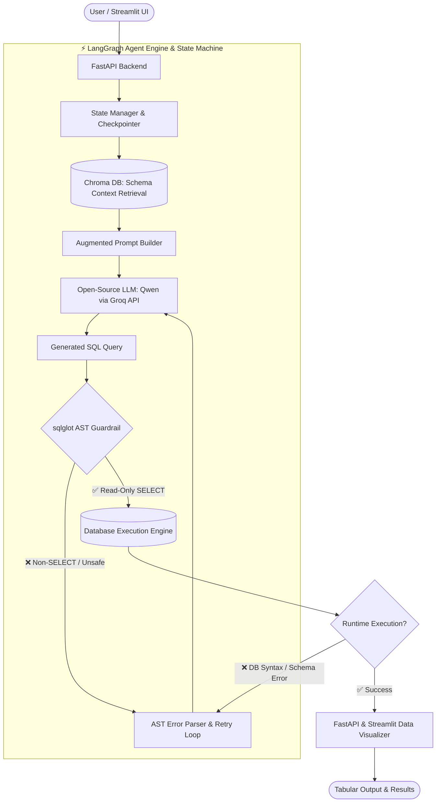

<div align="center">

# Text-to-SQL Agent

**Ask questions in plain English. Get guarded SQL and answers from your SQLite data.**

[](https://www.python.org/)
[](https://fastapi.tiangolo.com/)
[](https://streamlit.io/)
[](https://www.sqlite.org/)

</div>

Ask questions about a SQLite database in plain English and get an answer backed by generated SQL. The application combines Groq, schema retrieval, LangGraph workflow orchestration, SQLite, and a Streamlit chat interface.

It ships with a small `employees` database so you can run it immediately, and it can accept another local SQLite database through the web interface.

## Contents

- [What it does](#what-it-does)
- [Architecture](#architecture)
- [Quick start](#quick-start)
- [Using the terminal client](#using-the-terminal-client)
- [Using your own SQLite database](#using-your-own-sqlite-database)
- [API walkthrough](#api-walkthrough)
- [Safety model and limitations](#safety-model-and-limitations)
- [Troubleshooting](#troubleshooting)

> This is a local development project. Do not expose its API publicly or upload a database containing sensitive data without adding authentication, authorization, file validation, and operational security controls.

## What it does

For a question such as “Which Engineering employees earn more than 100000?”, the application:

1. Finds the database tables and columns most relevant to the question.
2. Sends the question and that schema context to the configured Groq model.
3. Asks the model to return a SQL `SELECT` query.
4. Parses the SQL with `sqlglot`, blocks non-`SELECT` statements, and adds a result limit when needed.
5. Runs the safe query against SQLite.
6. Uses the result to prepare a short natural-language response.
7. Displays both the answer and the SQL/result in the Streamlit UI.

## Architecture



### Main components

| File or folder | Responsibility |
| --- | --- |
| `app.py` | Streamlit chat UI and database upload controls. |
| `api.py` | FastAPI endpoints, application startup, request handling, and workflow state. |
| `main.py` | Terminal-based chat client for running the same workflow without the browser. |
| `main_db_setup.py` | Creates and seeds the default `data/enterprise.db` database. |
| `core/workflow.py` | The LangGraph nodes: SQL generation, guarded execution, retry routing, and response summary. |
| `core/vector_retriever.py` | Reads the SQLite schema, embeds table descriptions, and retrieves relevant tables. |
| `guardrails/ast_validator.py` | Parses generated SQL and only allows `SELECT` expressions; it also applies a row limit. |
| `data/` | Runtime databases and LangGraph checkpoint files. This is generated local state and is ignored by Git. |

## Prerequisites

- Python 3.11 or newer
- A [Groq API key](https://console.groq.com/keys)
- Internet access the first time the sentence-transformer model is downloaded

The project is configured to use `qwen/qwen3.8-27b` through Groq. If that model is unavailable for your Groq account, update the model name in `api.py` and `main.py` to one available to you.

## Quick start

Run these commands from the project root.

### 1. Create and activate a virtual environment

Windows PowerShell:

```powershell
py -3.11 -m venv .venv
.\.venv\Scripts\Activate.ps1
```

macOS/Linux:

```bash
python3.11 -m venv .venv
source .venv/bin/activate
```

If PowerShell blocks activation, run the following once for your user account, restart PowerShell, and activate again:

```powershell
Set-ExecutionPolicy -Scope CurrentUser RemoteSigned
```

### 2. Install dependencies

```bash
python -m pip install --upgrade pip
python -m pip install -r requirements.txt
```

### 3. Create your environment file

Create a file named `.env` beside `api.py`:

```dotenv
GROQ_API_KEY=your_groq_api_key_here
```

Do not commit `.env`, share it, or paste the key into the browser. The existing `.gitignore` excludes virtual environments and runtime data; keep `.env` private as well.

### 4. Start the backend

Open a terminal in the project root and run:

```bash
uvicorn api:app --reload
```

Wait for a message similar to `Text-to-SQL Agent API` being ready. On its first startup the service creates `data/enterprise.db`, indexes its schema, and creates a local LangGraph checkpoint database.

The API is then available at:

- Interactive docs: <http://127.0.0.1:8000/docs>
- OpenAPI schema: <http://127.0.0.1:8000/openapi.json>

### 5. Start the web UI

Open a second terminal, activate the same virtual environment, and run:

```bash
streamlit run app.py
```

Open the local URL shown by Streamlit, usually <http://localhost:8501>.

Try these starter questions:

- `List all employees.`
- `Who works in Engineering?`
- `What is the average salary by department?`
- `Show employees earning more than 100000.`

## Using the terminal client

The CLI uses the same core workflow but does not require FastAPI or Streamlit to be running:

```bash
python main.py
```

Useful CLI commands:

- `reset` — starts a fresh conversation thread.
- `exit` or `quit` — ends the program.

## Using your own SQLite database

1. Start the backend and UI.
2. In the left sidebar, choose a `.db` or `.sqlite` file.
3. Click **Load Uploaded Database**.
4. Wait while the application reads and indexes the database schema.
5. Ask questions about tables and columns in that database.

The backend saves the uploaded file under `temp_uploads/` and creates a schema retriever for it. Switching databases resets the UI thread so prior conversation state does not leak into the new database.

### Current upload limitation

The selected upload is passed to the SQL execution node, but `api.py` compiles the LangGraph workflow once at startup using the default database's schema retriever. In other words, an uploaded database can be queried, but the model may still receive schema context from `enterprise.db` rather than the uploaded file. Upload support is therefore experimental until the API creates or selects a graph compiled with the matching retriever for each active database.

For best results, use a normal SQLite database with clear table and column names. Questions should mention the business concept you want, not necessarily the precise column name.

## API walkthrough

The UI calls two endpoints.

### `POST /chat`

Request body:

```json
{
  "message": "What is the average salary by department?",
  "thread_id": null,
  "db_path": null
}
```

Example PowerShell request:

```powershell
$body = @{
  message = "What is the average salary by department?"
} | ConvertTo-Json

Invoke-RestMethod -Method Post `
  -Uri http://127.0.0.1:8000/chat `
  -ContentType "application/json" `
  -Body $body
```

Response fields:

| Field | Meaning |
| --- | --- |
| `thread_id` | The LangGraph conversation identifier. Send it again to continue the same conversation. |
| `response` | The generated natural-language answer. |
| `generated_sql` | The final SQL query retained by the workflow. |
| `execution_result` | The raw SQLite rows returned by that query. |

### `POST /upload-db`

Accepts a multipart file named `file`. Only `.db` and `.sqlite` filenames are accepted by the current API. A successful response includes the server-side `db_path`; pass that value as `db_path` to `/chat` when calling the API directly.

## How the workflow works

`core/workflow.py` defines a three-node LangGraph workflow:

```text
START
  │
  ▼
generate_sql ──► execute_sql ──► summarize ──► END
                     │
                     └── retry generate_sql when execution reports an error
```

- **Generate SQL:** retrieves the two most relevant table descriptions and prompts Groq to produce SQL only.
- **Execute SQL:** calls `enforce_sql_guardrails`, then runs the approved query against the selected SQLite database.
- **Retry:** if execution reports an SQL error, the graph can ask the model to correct the query, up to its configured retry condition.
- **Summarize:** turns the row data into a short answer for the user.

## Safety model and limitations

The project includes an important first line of defense, but it is not a complete production security system.

- `guardrails/ast_validator.py` parses generated SQL with `sqlglot` and only permits `SELECT` statements.
- Queries without a limit receive a limit of 50 rows; larger limits are reduced to 50.
- The workflow catches rejected or malformed SQL and returns an execution error to the graph instead of running it.
- The model prompt also asks for `SELECT` SQL only.

Still, treat this as a development tool:

- The API does not have authentication or per-user database authorization.
- Uploaded files are stored locally and are not automatically removed.
- A user who can reach the API can provide a server-side `db_path`; do not expose it outside a trusted machine.
- The guardrail limits SQL operation type, but it does not decide whether a user is authorized to view particular rows or columns.
- LLM output can be wrong. Always review generated SQL and results before using them for important decisions.

For production use, add authentication, database allowlists, role/row/column-level access control, upload scanning and size limits, rate limits, audit logs, secrets management, and a database account with strictly read-only permissions.

## Troubleshooting

### `GROQ_API_KEY is required` or authentication errors

Confirm `.env` is in the project root, uses the exact key name `GROQ_API_KEY`, and restart the backend after editing it.

### The UI says it cannot connect to the backend

Start the API first with `uvicorn api:app --reload`. The Streamlit UI expects it at `http://127.0.0.1:8000`. If you intentionally use another host or port, update `API_BASE_URL` in `app.py`.

### First startup is slow

`sentence-transformers` may download `all-MiniLM-L6-v2` on first use. Later starts should reuse its local model cache.

### `ModuleNotFoundError`

Ensure the virtual environment is activated, then reinstall dependencies:

```bash
python -m pip install -r requirements.txt
```

### A query is blocked or fails

Inspect the generated SQL shown in the UI or API response. The application intentionally blocks non-`SELECT` SQL. For read queries, try a more specific question that names the relevant business concept or table.

### Reset local runtime state

Stop the API first. You can then delete generated SQLite files under `data/` and start the API again; `enterprise.db` will be recreated and seeded. Do not delete a database you intend to keep.

## Project layout

```text
text_to_sql/
├── api.py                   # FastAPI service
├── app.py                   # Streamlit UI
├── main.py                  # Terminal client
├── main_db_setup.py         # Default SQLite database setup
├── core/
│   ├── workflow.py          # LangGraph workflow
│   └── vector_retriever.py  # Schema retrieval
├── guardrails/
│   └── ast_validator.py     # SQL SELECT-only validation and limits
├── data/                    # Local runtime databases/checkpoints
├── temp_uploads/            # Uploaded SQLite files
├── requirements.txt
└── .env                     # Your local secret; do not commit
```
